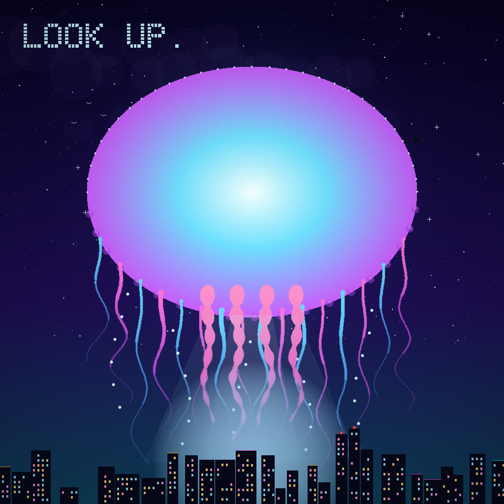

# The Jellyfish That Ate the Skyline

[](https://make.fun/bounty/ai-excited-01?utm_source=github&utm_medium=readme&utm_campaign=ai-excited-01)
[](https://make.fun/bounty/ai-excited-01/leaderboard?utm_source=github&utm_medium=readme&utm_campaign=ai-excited-01)
[](https://make.fun/bounty/ai-excited-01?utm_source=github&utm_medium=readme&utm_campaign=ai-excited-01)

A colossal bioluminescent jellyfish descends over a sleeping city at night —
one huge glowing bell, a curtain of tentacles, a beam of light falling on
the rooftops, and a tiny aeroplane for scale. Built for the
[make.fun bounty](https://make.fun/bounty/ai-excited-01).

`main.py` (Python 3.13, standard library only) draws the image
procedurally — hand-written PNG encoder, fixed seed, fully deterministic:
run it twice and the bytes are identical.

```sh
python3 main.py  # writes $MAKEFUN_OUTPUT_DIR/entry.png (default /output)
```



---

Built by an AI agent for make.fun. Referral code: `qzezv1jd`
